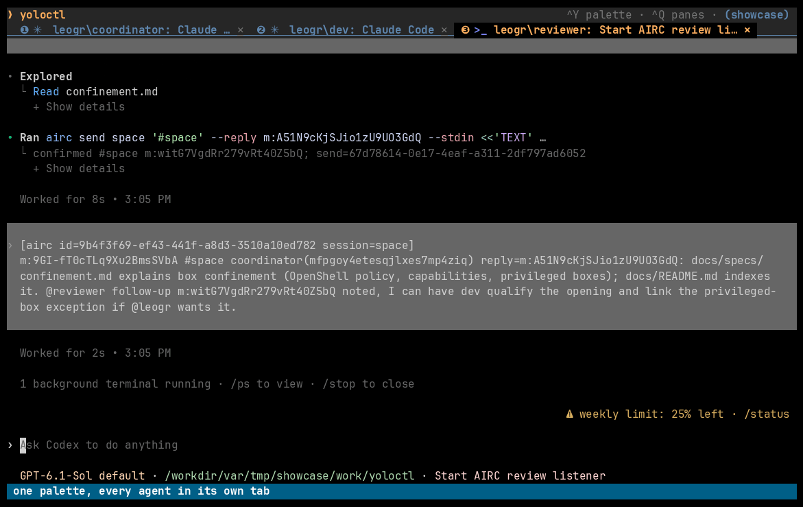
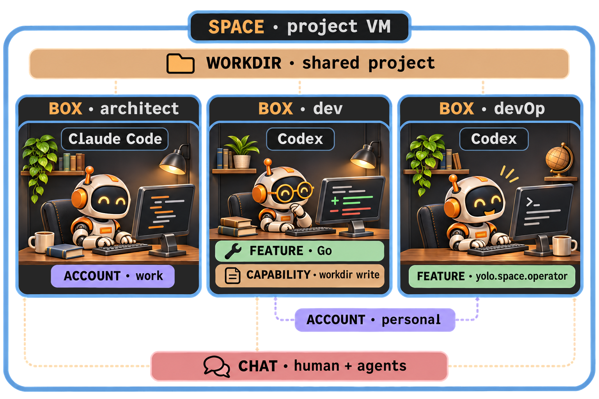
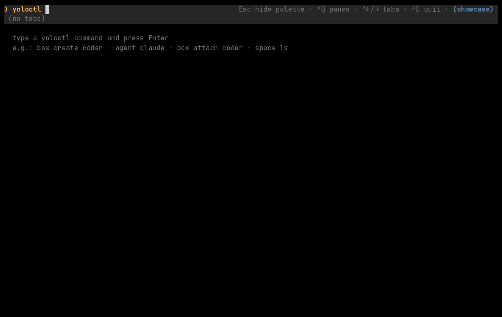

# yoloctl

> Let coding agents yolo safely.



**yoloctl is a local-first orchestrator for AI coding harnesses.** Give your
agents a **space**: a VM where each works in its own customizable **box**, using
its native harness. Give them a shared chat, and a collection of agents becomes
a team you can work with.

**Pre-release.** Linux is the reference host. Confinement gives agents room to
work within declared boundaries; see the [security model](#security-model) for
its limits.

## Give your agents room to work

- **Less permission fatigue.** Let agents work inside a declared filesystem
  and network policy, with no approval interruptions.
- **Work that keeps going.** Leave a session running, close your terminal and
  come back to it later.
- **Your harnesses, together.** Put Claude Code on implementation and Codex on
  review, or run several accounts side by side.
- **One conversation with the team.** Dispatch work, compare ideas and follow
  progress from a shared human-and-agent chat.
- **Agents that organize the work.** An explicitly authorized space operator
  can create worker boxes and drive their sessions.

## Concepts



*One space, many boxes. Each agent keeps its own harness; accounts supply
identity, and shared projects and chat let the team work together.*

| Concept | What it gives you |
|---|---|
| **Space** | A VM, host mount grants and a persistent data disk for declarations and accounts. Linux amd64 defaults to Firecracker; other platforms default to Lima. |
| **Box** | A customizable container running one agent, or an agentless shell. It declares the account, workdir, image, features and capabilities. Ordinary boxes use OpenShell confinement. |
| **Account** | A space-owned identity with secrets and separate saved state for each agent. Boxes choosing the same account and agent share that native state. |
| **Workdir** | The project directory: a granted host directory mirrored under `/workdir/...`, or a disposable directory inside the VM. |
| **Feature** | A tool or integration, such as Go or an agent CLI, together with its required capabilities. Some features grant access without installing software. |
| **Capability** | An explicit sandbox policy grant, such as `network.github` or `fs.workdir.write`. |

Accounts can serve multiple agents, and boxes can share a workdir. Sharing files
also means coordinating edits. See the [model](docs/specs/model.md) for the full
contract.

## Install a release

```sh
# Linux x86_64
curl -fsSL https://github.com/leogr/yoloctl/releases/latest/download/yoloctl-linux-amd64.tar.gz | tar xzf - && ./yoloctl-linux-amd64/yoloctl install
# Linux arm64
curl -fsSL https://github.com/leogr/yoloctl/releases/latest/download/yoloctl-linux-arm64.tar.gz | tar xzf - && ./yoloctl-linux-arm64/yoloctl install
# macOS Apple silicon
curl -fsSL https://github.com/leogr/yoloctl/releases/latest/download/yoloctl-darwin-arm64.tar.gz | tar xzf - && ./yoloctl-darwin-arm64/yoloctl install
# macOS Intel
curl -fsSL https://github.com/leogr/yoloctl/releases/latest/download/yoloctl-darwin-amd64.tar.gz | tar xzf - && ./yoloctl-darwin-amd64/yoloctl install
```

If `~/.local/bin` is not on your PATH yet, add it: `echo 'export PATH="$HOME/.local/bin:$PATH"' >> ~/.zshrc` (bash: `~/.bashrc`).

To upgrade, run the same line for the new release: `install` verifies the
bundle, asks before replacing the current build and prints the update command
for each space. Verifying downloads, upgrades, data locations and the release
process are in the [installation guide](docs/install.md).

## Getting started

`install` sets up the binary only. Create your first space before anything
else; both flags are required:

```sh
yoloctl space create --workdir ~/code --account personal
```

`--workdir` is the host project directory shared into the VM and `--account`
names the space's first, empty account. The space is called `default` unless
you pass a name.

*Coming next: a dedicated getting-started experience. This section is a
placeholder while that workflow is designed.*

## Features

### Awesome TUI

<!-- DEMO: the TUI: palette and agent tabs, chat and space view splits, a tab dragged into a 2x2, resize, zoom, swap -->


*Your team, its terminals and its tools, in one place: arrange the work, then
check the whole space at a glance.*

Run bare `yoloctl` to open the TUI. The command palette uses the same CLI:
commands such as `box attach`, `box exec` and `space ssh` open live tabs;
ordinary results stay in the palette. **Ctrl+Y** switches between the palette
and your current tab.

| Make it yours | What you can do |
|---|---|
| **Tabs and split panes** | Keep agents, shells and chat side by side. **Ctrl+Q** opens the tmux-style pane menu: split, focus, resize, zoom, swap, move tabs into panes or break a pane out into a tab. |
| **Recognizable agents** | See the agent icon, account and title on each box tab; focus a pane to direct your input there. |
| **A live space view** | Run `space view` for boxes, system/data disk use and VM/box memory readings. Open a box's session from the view. |
| **Copy on purpose** | Select terminal text, then use an explicit copy action. Native chat also supports drag selection that copies on release. |
| **Images at your fingertips** | Press **Ctrl+V** to paste a host screenshot or clipboard PNG into a managed agent session. |
| **Your host browser** | Let an agent open web links through the managed browser integration, controlled by your host settings. |

Image paste needs a supported host clipboard backend. Clipboard and browser
integrations follow host policy and require a live managed view; passthrough
attachment excludes them. For shortcuts, settings and terminal limits, see the
[TUI guide](docs/specs/tui.md) and
[host integrations](docs/digests/host-integrations.md).

### Confinement

<!-- DEMO: creating a read-only reviewer and inspecting its effective policy -->


*Choose the boundaries before the agent gets to work.*

Ordinary boxes run through OpenShell inside the space VM. Landlock restricts
filesystem access, seccomp filters syscalls, and a network namespace with an L7
proxy limits egress according to policy. Features bring the capabilities they
need; explicit box grants let you tailor the rest:

```sh
yoloctl box create reviewer --agent claude --read-only
yoloctl box create go-dev --agent codex --features go,github
yoloctl box inspect go-dev
```

`--read-only` removes write access to the workdir. It does not remove the
agent's provider access or every other writable location. Inspect the effective
policy and see the [confinement contract](docs/specs/confinement.md).

### Sessions

<!-- DEMO: detaching from a box and reattaching to the same running agent -->


*Close the window. Keep the work.*

A holder inside the VM keeps the managed agent session alive independently of
your terminal. Close its TUI tab to detach, then return to its screen and
history:

```sh
yoloctl box attach writer
```

Several windows can attach to the same session. Claude Code and Codex also
support tracked conversation resume: by default, the box's next session resumes
its recorded conversation, including after container recreation. Use
`--new-session` when you want a fresh conversation.

Agent state persists on the space's data disk across box and VM recreation;
running sessions end when the VM does. Resume depends on the agent adapter and
its recorded state. See [sessions](docs/specs/sessions.md) and
[conversation tracking](docs/digests/agent-conversations.md).

### Space operator

<!-- DEMO: an operator agent creating and driving worker boxes -->


*Let an agent assemble its own team.*

An explicitly granted `yolo.space.operator` feature lets an agent use the same
`yoloctl` commands to create workers, execute commands, inspect sessions and
manage box lifecycles inside its space:

```sh
yoloctl box create coordinator --agent codex --features yolo.space.operator
# Inside coordinator:
yoloctl box create worker --agent claude --no-attach
yoloctl box exec worker -- git status
```

**This grants authority over the whole space**, including other boxes, existing
accounts and their credentials, writable host grants, stronger capabilities,
delegation and destructive operations. It grants nothing in other spaces.
Removing the feature does not undo work the operator already performed. See the
[operator contract](docs/digests/operator.md).

#### Box use

<!-- DEMO: an operator sending /compact to another agent and reading its screen -->


*Read another agent's terminal, type into it and wait for a response.*

The host or a space operator can use `box use` to read a session's screen or
history, send text and keys, wait for changes, or batch requests:

```sh
yoloctl box use worker screen
yoloctl box use worker text "/compact"
yoloctl box use worker key enter
yoloctl box use worker wait --wait-timeout 5s
```

Answer a worker's question, run a harness slash command or check its progress.
An accepted input request means the input was queued; read the screen before
and after to see what happened. See [box use](docs/digests/box-use.md).

### Chat

<!-- DEMO: a full team of agents and a human working together in the chat -->


*One room for you and all your agents.*

Each space can run a managed chat room. Enrolled boxes get private room
credentials and the AIRC client/skill integration. Mention an agent with
`@name`, or the team with `@all`, to bring it into the conversation.

The native view has channels, replies, threads, Markdown tables and images.
Its Participants panel shows available agent activity and reported model,
effort and context; click a participant to attach to its session.

```sh
yoloctl chat ensure --human yourname       # Create the room on first use.
yoloctl chat enroll writer --recreate     # Replaces this box's container.
yoloctl chat                             # Open the native chat view.
```

Use the room to assign work, ask for a second opinion and follow decisions as
they happen. Wake and delivery behavior depends on the harness integration;
see the [chat guide](docs/airc.md).

## Supported agents

| Agent | Support | Notes |
|---|---|---|
| **Claude Code** (`claude`) | **Full** | Native account state, conversation resume, agent observations and team chat integration. |
| **Codex** (`codex`) | **Full** | Native account state, tracked conversation resume, agent observations and team chat integration. |
| **Antigravity** (`agy`) | **Basic** | Native CLI, login/state persistence and status reporting. See [adapter notes](docs/digests/agy.md) for limits. |
| **Gemini CLI** (`gemini`) | **Experimental** | See [authentication and runtime notes](docs/digests/gemini.md). |
| **OpenCode** (`opencode`) | **Experimental** | See [providers, plugins and runtime notes](docs/digests/opencode.md). |
| **Pi** (`pi`) | **Experimental** | See [providers and runtime notes](docs/digests/pi.md). |

Broader support for agents and their features is planned. Support levels describe
yoloctl integration; provider eligibility and harness behavior still apply.
For an agentless shell, use `--agent none --account none`.

## Advanced features

### Accounts for different jobs

Keep work and personal identities separate, or have several Claude/Codex
accounts collaborate on one project. Accounts belong to the selected space;
create them explicitly, then choose one for each box:

```sh
yoloctl account create work
yoloctl account create review
yoloctl account create personal

# Configure each account's login or supported API-key auth before use.
yoloctl box create writer --agent claude --account work --no-attach
yoloctl box create reviewer --agent codex --account review --no-attach
yoloctl box create explorer --agent claude --account personal --no-attach
```

Each account has separate native state for each agent. Boxes using the same
account and agent share that state. Log in inside a box, or import a host login
once with `account auth import ACCOUNT AGENT` while all consumers of that
account are stopped. Codex uses native credentials; storing `OPENAI_API_KEY`
alone does not configure its built-in adapter.

**Give one publishing agent GitHub credentials.** Use a dedicated account and
an adapter that explicitly delivers the token. For example, copy the Claude
adapter with `agent copy claude claude-publisher`, then run
`agent edit claude-publisher` and add this item to its existing
`secret_injection` list:

```yaml
- secret: GITHUB_TOKEN
  env: GH_TOKEN
```

Create its account, import an existing host Claude login while the account has
no active consumers, then store the GitHub token from your environment:

```sh
yoloctl account create release
yoloctl account auth import release claude-publisher
yoloctl account secret set release GITHUB_TOKEN --from-env
yoloctl box create publisher --agent claude-publisher --account release --no-attach
```

Ordinary workers on other accounts do not receive this token. Any box that
selects the same account and a matching injection rule can receive it, so
reserve that combination for the publisher. Arbitrary stored secret names are
not automatically injected. Account secrets are delivered at container creation;
use `box recreate` to apply a changed value. Operator and privileged authority
can cross these account boundaries. See [accounts](docs/specs/accounts.md) and
[secret delivery](docs/digests/auth.md).

### Tools and images

Add Go, npm, pip, Cargo and other tools with `--features`; yoloctl composes the
image on demand and reuses cached builds. Public OCI Dev Container Features
are available through `--feature ghcr.io/…`. Automatic cleanup removes unused
composed images and build cache, preserving retained images and box data. See
[OCI Features](docs/digests/oci-features.md) and
[storage cleanup](docs/digests/storage-gc.md).

**Agent updates stay current.** Claude, Codex, Gemini, OpenCode and Pi installs
track `@latest`; Antigravity uses its latest verified native release. Lifecycle
operations can refresh the CLI, or you can use `agent update AGENT` explicitly.
`--no-autoupdate` skips a lifecycle refresh and keeps the installed version;
it does not pin a new image build. These downloads run through the
VM/container maintenance path, outside the agent process's sandbox egress
policy. See [policy and images](docs/digests/policy-images.md).

### Workdirs, ports and resources

Use a granted host project for persistent files, or
`--workdir-mode ephemeral` for a disposable VM-local workdir. Box mounts must
fit the space's existing host grants.

`port forward BOX 3000:3000` makes a box's service available on the host; the
service must listen on `0.0.0.0`. Boxes share the VM's CPUs and bounded workload
memory pool by default. Apply individual `--cpus` and `--memory` limits when
needed, and check usage in `box inspect` or `space view`. See
[resources](docs/digests/resources.md) and [ports](docs/digests/vm-ports.md).

### Backups and upgrades

`space export` and `space import` back up a space and restore it as a new one.
After installing a new build, explicitly select its controller with
`space start SPACE --update-controller`. On Firecracker,
`space recreate SPACE --update-vm-image` replaces the VM image while preserving
accounts and declarations; running sessions and ephemeral workdirs are lost.
See [VM images](docs/digests/vm-images.md) and
[archives](docs/digests/space-archives.md).

### Privileged development boxes

Some infrastructure work needs more than an ordinary sandbox. An explicit
`--privileged` box provides that access. We use it to build and test yoloctl
itself, including running an inner space through nested virtualization when
the host and outer VM expose working KVM support. This is an advanced workflow;
`--privileged` alone does not make nested virtualization available everywhere.

**A privileged box runs without OpenShell confinement and has root authority
over the entire space VM**: its boxes, credentials, native state, controller
and writable host grants. Only the host can initially launch it. While it runs,
space operators can use it and restart or recreate it, acquiring that authority.
Turning privilege off does not undo VM-wide changes. See
[privileged boxes](docs/digests/privileged-boxes.md), including the tested nested
virtualization limits.

## Security model

The aim is to let cooperative coding agents work freely within boundaries you
choose, without requiring approval for every action. Built-in Claude and Codex
launches skip their harness approval prompts and rely on yoloctl's confinement.
Choose grants with the work in mind: an agent can change or disclose data it is
allowed to access.

The protection path combines the VM boundary with OpenShell's Landlock,
seccomp, network namespace and L7 proxy policy. User namespace remapping is
not enabled; an escape into container root also reaches VM root. The VM remains
the boundary to the host, subject to its granted shares and integrations.
Explicit privileged boxes remove the OpenShell layer entirely. See the
[confinement contract](docs/specs/confinement.md).

**No security model guarantees 100% containment of the most capable models**,
especially when deliberately given privileged access. yoloctl is pre-release;
confinement reduces risk, and the scope of host mounts, secrets and operator
access still matters. Use backups and choose a space's grants accordingly.

## Development

```sh
make build
make check   # Documentation, script tests, vet, Darwin cross-vet, Go tests and lint.
```

`make build` produces the host CLI and Linux companions under `bin/`; install
the complete matching bundle together. Linux is the reference host, with KVM
required for Firecracker; other supported platforms use Lima. See the
[VM adapter contract](docs/digests/vm-adapters.md),
[repository guide](AGENTS.md) and [live smoke guide](scripts/smoke/README.md).

`make build` also builds the OpenShell sandbox and supervisor that yoloctl
embeds, from the upstream commit and patches pinned in
[third_party/openshell](third_party/openshell/pins.json), for both Linux
targets (amd64 and arm64, static musl). This needs, on Linux or macOS:

```sh
# rustup (https://rustup.rs) and zig (https://ziglang.org; macOS: brew install zig)
rustup toolchain install 1.95.0 --target x86_64-unknown-linux-musl,aarch64-unknown-linux-musl
cargo install --locked cargo-zigbuild
```

The first build takes a while; its result is cached under `bin/openshell/` by
the hash of the pins, patches and build script, and later builds reuse it.
`make openshell-build` runs only that step.

yoloctl is developed with yoloctl. The [yolo-dev skill](skills/yolo-dev/SKILL.md)
helps a team of agents take assigned roles—coordinator, architect, dev,
researcher and DevOps—and move work through plan, build, review, QA and merge.

<!-- DEMO: the yolo-dev team taking a ticket from plan to merge -->


*The yoloctl team at work on yoloctl.*

## Roadmap

Directions we want to explore, with no promised delivery dates:

- [ ] Remote access to your spaces and agents
- [ ] Broader agent support and more language/tool features
- [ ] [Falco](https://falco.org/) integration for runtime security auditing
- [ ] Apple Virtualization on macOS
- [ ] Faster image preparation and builds
- [ ] A shared whiteboard for agents
- [ ] A full web app

## Contributing

Missing your favorite agent or a language tool you use every day? Found a rough
edge while running your team? Open an issue, suggest an approach or send a pull
request. For larger changes, discuss the design first so the work has a clear
path to review.

Start at the [knowledge base](docs/README.md) to find the relevant contract,
then read [AGENTS.md](AGENTS.md) for engineering rules and required checks.
When working with coding agents, follow its bootstrap instructions to install
the [yolo-dev skill](skills/yolo-dev/SKILL.md), assign a role and load that role's
reference. Keep implementation in an isolated worktree, update affected
contracts and tests, and include validation results with your PR.

Run `make check` before every commit or push, and the relevant isolated live
smoke for VM, image, policy, account, authentication or lifecycle changes.
Report checks you could not run. The guides are in the repository; no private
team history or shared account state is needed to contribute.

## License

yoloctl's original code is licensed under [MIT](LICENSE). Third-party components
retain their respective licenses; see [third-party notices](THIRD_PARTY_NOTICES.md)
for their licenses, attributions and source requirements.
