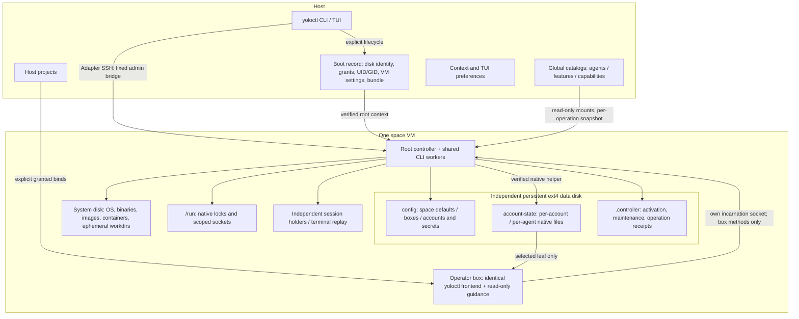

# Space controller and operator boundary

[FACT] One controller inside each VM owns defaults, box/account declarations and
secrets on the native data disk. The host owns boot authority, host grants,
catalogs and UI preferences. There is no installed host daemon, shared declaration writer,
or host/guest advisory lock. The Firecracker adapter has one private host helper
per running VM for device transport; it has no controller authority.
[1](#source-1) [2](#source-2) [5](#source-5)

[FACT] Ordinary declaration/runtime commands require a running, matching
controller; they never boot or perform offline declaration edits. `space start`
and explicit import/update own deployment. Recreate retains the data disk;
destroy deletes it after VM termination. An interrupted mutation is queried by
request ID and never automatically replayed.
Fixed worker infrastructure is claimed before runtime verification can launch
a child; optional launch observations do not authorize effects. [1](#source-1)
Every mutation durably authorizes effects, with its footprint, over a private
worker channel; confirmed cancellation before authorization is `recovered`
`not-applied`. The controller also resolves an outcome from a durable
completion record or a reviewed read-back of an exact account or chat-revoke
document. An outcome it cannot prove holds only its recorded boxes, accounts
and shared domains until a host reviews it; an unbounded one holds the space.
Receipt-storage recovery rechecks current UUID, ownership and live bind
read-only before reopening; workers and verifiers never prepare that bind.
[15](#source-15)
An authorized `box exec` command whose result is lost is instead
`command-uncertain`: queryable and never replayed, without a hold.
Interrupting a `box attach`/`box use` client never creates that hold: before
authorization it cancels cleanly; after it the controller finishes setup, which
may start a session after the client left. A signal before handoff ends the
client (status 75), never the setup. [12](#source-12)
A refusal names the held resources and, for hosts, the review commands
(`--acknowledge-all` and per-ID); acknowledgment neither retries nor undoes an
operation and never covers still-running work.
[1](#source-1) [3](#source-3)

[FACT] Image preparation is a separate controller-owned phase, outside native
space/entity apply guards. Each attempt exports privately; only the controller
publishes public tags after the requesting operation is permitted. Last-requester
cancellation or recovery abandonment immediately releases capacity and same-input
waiting. Its output remains non-consumable and residual work remains accounted
for; no image-preparation acknowledgment or history wait is required. Legacy
unqualified effects and public apply keep their existing recovery rules.
Each requester receives plain build logs through stderr, with bounded independent
delivery for joined clients and quiet-phase feedback. Interactive clients keep
these lines at column zero while raw, without rewriting session output or
redirected stderr.
Managed requests retain their private view channel throughout preparation and
revalidation, including queued input for the eventual attachment.
[16](#source-16)

[FACT] Firecracker PID 1 restarts an abnormally exited controller only after
verified worker cleanup, beginning with a five-second delay. Five automatic
attempts per episode are bounded; 60 seconds of process uptime resets that
budget, so a slow crash loop can continue indefinitely and remains visible in
guest-log cumulative counts. Stop cancels and joins restart work. Restart does
not replay commands, clear maintenance/holds or establish build termination.
Existing spaces require an explicit VM-image recreate to install this policy.
[17](#source-17)

[FACT] Two kinds of background work run as short-lived `controller-internal`
workers on an idle, certain controller and yield to every admitted mutation:
disposable storage cleanup and, while someone reads the box inventory, at most
one read per minute of the daemon of each live tracked Codex launch. Neither is an
operation: no receipt, never replayed. [13](#source-13) [14](#source-14)

[FACT] `yolo.space.operator` is opt-in full box authority within one space, including
existing accounts, stronger capabilities and delegation. Per-incarnation socket
access and live server checks enforce scope; CLI help and skills do not enforce
security. Binary copies and shared account state do not transfer authority.
[4](#source-4)

[FACT] A privileged box (`privileged: true`) limits that authority only at
launch: operators may declare, manage, stop and destroy privileged boxes and
exec in, attach to or use a running one, gaining space-VM root, but never create
or start a privileged container. Restart/recreate of a box the same request proved to be a
running current privileged launch continues it. Declared, stale or uncertain
runtime privilege counts. Host launches warn that every operator gains that
access. [11](#source-11)

[DERIVED] Add future agent powers as explicit registered operations and grants
on this controller. Retain shared command validation, typed requests, exact
bundle compatibility and server-side scope checks; a helper-only restriction
would not protect a privileged executor. [1](#source-1) [4](#source-4)

[FACT] Managed chat separates durable native ownership/membership from observed
application. Host and explicitly authorized operator runtime operations ensure
the reserved server, render
private Unix configuration, reload membership and verify exact generation,
digest and live incarnation. Participant binds need explicit recreation.
The confined human JSONL stream has no host credentials or arbitrary command/file
operations; each view's stream registers the saved nickname, one human session
at a time: another view of the account is replaced only after an explicit Take
over. Desired-only recovery APIs still report runtime unapplied; unsupported
AIRC feature probes fail explicitly. Operators can administer membership and
named participant connections, while human view/settings and arbitrary server
execution/attachment remain host-only. [6](#source-6) [7](#source-7) [8](#source-8)

[FACT] The finite read-only `chat.channel.catalog` operation returns one verified
native desired manifest with an explicit runtime-unobserved discriminator.
It performs no room reread, runtime-wide inventory, mutation lock, repair or
retry; independent live operator authority checks remain required. Existing
list/status observations and all action-time checks retain their contracts.
[9](#source-9)

[FACT] Status/catalog observations and opening a verified healthy human stream
remain available during unrelated mutation locks. Opening first inspects readiness;
uncertain runtime evidence does not trigger automatic setup. [7](#source-7)

[FACT] Channel ACL mutations reuse that authority and require one verified
pre-reload/acknowledgment/post-reload incarnation. The stream rechecks current
native channel access before each channel operation. Trusted catalog refresh
can replace identities in an open stream without changing membership; stale
or equal-conflicting generations are rejected. List alone retries a concurrent
native change once within one five-second budget, retaining the initial room/disk/human
identity and repeating authority checks; status stays single-attempt. This behavior
requires deploying the controller with `space start --update-controller`. [9](#source-9)

[FACT] Host-only image publication uses a separate typed, effect-gated
operation with immutable room/channel identity and at most 4 MiB of validated
PNG bytes on stdin. It invokes the confined artifact CLI without a new IRC
connection or staging mount. A possible publication with no verified reply
remains uncertain; no upload is replayed automatically. Transcript attachment
metadata comes only from validated reserved tags, never message text.
[10](#source-10)

[FACT] Audit control/viewing/export are host-only registered operations;
operator authority grants no audit access. Desired state is native, while a
separate audit receipt domain isolates uncertain control from unrelated boxes.
Startup reconciliation skips reserved/held audit state and retains the existing
global uncertainty rules. Firecracker uses a fixed PID-1 collector unit and a
read-only support query before toggles; unsupported media needs explicit host
image recreation. [18](#source-18)

## Sources

1.  [Controller implementation](../digests/controller.md).
2.  [Ownership and paths](../digests/declarations.md).
3.  [Lifecycle and archives](../digests/lifecycle.md).
4.  [Operator scope and guidance](../digests/operator.md).

5.  [VM adapters and helper lifetime](../digests/vm-adapters.md).
6.  [Managed chat state and limits](../digests/managed-chat.md).
7.  [Managed runtime and stream](../digests/chat-runtime.md).
8.  [Operator chat and human identity boundary](../digests/operator-chat.md).
9.  [Managed channel catalog and stream](../digests/chat-channels.md).
10.  [Image publication and recovery](../digests/chat-images.md).
11.  [Privileged development boxes](../digests/privileged-boxes.md).
12.  [Owned attach setup and client loss](../digests/attach-setup.md).
13.  [Automatic VM storage cleanup](../digests/storage-gc.md).
14.  [Codex refresh read](../digests/codex-refresh-read.md) — the controller's Codex daemon read.
15.  [Interrupted-outcome recovery](../digests/controller-recovery.md).

16.  [Controller image preparation](../digests/image-preparation.md).
17.  [Controller process supervision](../digests/controller-supervision.md).

18.  [VM-native audit contracts](../digests/audit.md).
